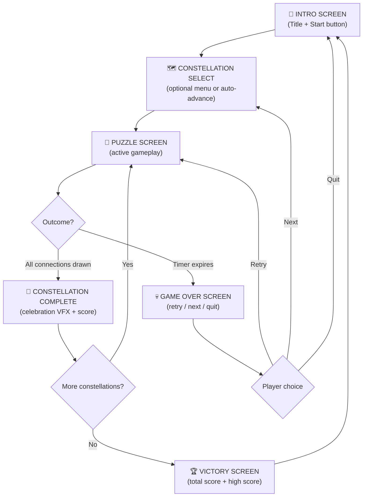

# 🌌 Voyager — Game Design Document

**Version:** 1.0.0  
**Last Updated:** 2026-11-17  
**Status:** Living Document — maintained by the QA agent

---

## 📋 Executive Summary

**Voyager** is a browser-based, single-player puzzle game built with pure HTML5 Canvas and Vanilla JavaScript. The player studies a procedurally-rendered night sky and connects the dots of real astronomical constellations, tracing the same star patterns that guided humanity for millennia.

| Property | Value |
|----------|-------|
| **Genre** | Puzzle / Educational |
| **Platform** | Web (desktop + mobile) |
| **Engine** | HTML5 Canvas + Vanilla JS (ES2022) |
| **Avg. Session** | 5–15 minutes |
| **Target Audience** | Ages 10+, astronomy enthusiasts, casual gamers |
| **Languages** | Spanish / English (bilingual) |
| **Dependencies** | None (optional: Google Fonts via CDN) |

---

## 🎮 Detailed Game Mechanics

### Core Loop

```
START
  └─► Show Intro Screen
        └─► Player selects (or is auto-assigned) a Constellation
              └─► Render star field + puzzle stars
                    └─► Player clicks Star A (selected / highlighted)
                          └─► Player clicks Star B
                                ├─ [VALID connection] → Draw line, add score
                                │     └─► All connections done? → CELEBRATE → Next constellation
                                └─ [INVALID connection] → Shake, −50 pts
```

### Star Selection

- Stars are rendered as glowing circular points on the canvas.
- **Hover** over a star → shows star name tooltip.
- **First click** → star becomes *selected* (brighter glow, ring indicator).
- **Second click on same star** → deselects.
- **Second click on different star** → attempt connection:
  - If a valid edge exists between the two → line drawn, both deselect.
  - If no valid edge → shake animation + −50 point penalty, both deselect.

### Connection System

- Each constellation has a predefined set of edges (connections), stored as `[star_id_A, star_id_B]` pairs.
- Connections are **undirected**: clicking A then B, or B then A, are both valid.
- A connection can only be drawn **once** (duplicate attempts are ignored without penalty).
- When every edge in the constellation has been drawn → **completion event fires**.

### Hint System

- Player may request a hint at any time during a puzzle.
- A hint reveals **one un-drawn connection** (flashes it briefly, then fades).
- **Cost:** −200 points per hint used.
- Hints remaining are shown in the HUD.

### Timer System

| Difficulty | Time Limit |
|-----------|-----------|
| ⭐ (1) | No timer |
| ⭐⭐ (2) | 180 seconds |
| ⭐⭐⭐ (3) | 120 seconds |
| ⭐⭐⭐⭐ (4) | 90 seconds |
| ⭐⭐⭐⭐⭐ (5) | 60 seconds |

- Timer ticks in real time.
- When time expires → **Game Over** screen, no score awarded for that constellation.
- Speed bonus calculated from remaining time at moment of completion.

### Progression

- Constellations are presented in order of difficulty (easiest → hardest).
- Completing all 10 constellations triggers the **Victory** (all-clear) screen.
- A cumulative total score is tracked across the entire session.

---

## ✨ Constellation Specifications

> All positions are on a normalized `[0, 100]` coordinate grid mapped to the canvas at runtime.

### 1. Cassiopeia ⭐ (Difficulty 1)

**Lore:** The Queen — a distinctive W-shape in the northern sky.  
**Stars:** 5 | **Connections:** 4 | **Time Limit:** None

| ID | Name | x | y | Magnitude |
|----|------|---|---|-----------|
| 0 | Caph | 10.0 | 60.0 | 2.27 |
| 1 | Schedar | 28.0 | 35.0 | 2.24 |
| 2 | Gamma Cas | 50.0 | 55.0 | 2.47 |
| 3 | Ruchbah | 72.0 | 32.0 | 2.68 |
| 4 | Segin | 90.0 | 50.0 | 3.38 |

**Connections:** 0→1, 1→2, 2→3, 3→4  
**Shape:** Classic W-zigzag

---

### 2. Crux ⭐ (Difficulty 1)

**Lore:** The Southern Cross — smallest of all 88 constellations; featured on 5 national flags.  
**Stars:** 5 | **Connections:** 4 | **Time Limit:** None

| ID | Name | x | y | Magnitude |
|----|------|---|---|-----------|
| 0 | Acrux | 50.0 | 85.0 | 0.76 |
| 1 | Mimosa | 78.0 | 50.0 | 1.25 |
| 2 | Gacrux | 50.0 | 15.0 | 1.63 |
| 3 | Delta Cru | 22.0 | 50.0 | 2.80 |
| 4 | Epsilon Cru | 60.0 | 62.0 | 3.59 |

**Connections:** 0→2 (vertical), 1→3 (horizontal), 0→4, 4→1

---

### 3. Orion ⭐⭐ (Difficulty 2)

**Lore:** The Hunter — one of the most recognizable constellations, visible from both hemispheres.  
**Stars:** 7 | **Connections:** 9 | **Time Limit:** 180s

| ID | Name | x | y | Magnitude |
|----|------|---|---|-----------|
| 0 | Betelgeuse | 38.0 | 28.0 | 0.50 |
| 1 | Bellatrix | 62.0 | 26.0 | 1.64 |
| 2 | Mintaka | 38.0 | 50.0 | 2.23 |
| 3 | Alnilam | 50.0 | 50.0 | 1.69 |
| 4 | Alnitak | 62.0 | 50.0 | 1.77 |
| 5 | Saiph | 38.0 | 74.0 | 2.07 |
| 6 | Rigel | 65.0 | 74.0 | 0.13 |

**Connections:** 0→1, 0→2, 1→4, 2→3, 3→4, 2→5, 4→6, 5→3, 6→3

---

### 4. Ursa Major ⭐⭐ (Difficulty 2)

**Lore:** The Great Bear — contains the Big Dipper asterism; pointer stars lead to Polaris.  
**Stars:** 7 | **Connections:** 7 | **Time Limit:** 180s

| ID | Name | x | y | Magnitude |
|----|------|---|---|-----------|
| 0 | Dubhe | 72.0 | 20.0 | 1.81 |
| 1 | Merak | 72.0 | 36.0 | 2.34 |
| 2 | Phecda | 55.0 | 40.0 | 2.44 |
| 3 | Megrez | 55.0 | 24.0 | 3.31 |
| 4 | Alioth | 38.0 | 20.0 | 1.76 |
| 5 | Mizar | 22.0 | 28.0 | 2.04 |
| 6 | Alkaid | 10.0 | 42.0 | 1.86 |

**Connections:** 0→1, 1→2, 2→3, 3→0, 3→4, 4→5, 5→6

---

### 5. Ursa Minor ⭐⭐ (Difficulty 2)

**Lore:** The Little Bear — Polaris at the tip has been the North Star for centuries.  
**Stars:** 7 | **Connections:** 7 | **Time Limit:** 180s

| ID | Name | x | y | Magnitude |
|----|------|---|---|-----------|
| 0 | Polaris | 50.0 | 15.0 | 1.98 |
| 1 | Kochab | 25.0 | 70.0 | 2.07 |
| 2 | Pherkad | 38.0 | 75.0 | 3.05 |
| 3 | Eta UMi | 42.0 | 60.0 | 4.95 |
| 4 | Zeta UMi | 48.0 | 48.0 | 4.32 |
| 5 | Epsilon UMi | 52.0 | 36.0 | 4.23 |
| 6 | Delta UMi | 55.0 | 25.0 | 4.36 |

**Connections:** 0→6, 6→5, 5→4, 4→3, 3→2, 2→1, 1→2

---

### 6. Lyra ⭐⭐ (Difficulty 2)

**Lore:** The Lyre — Vega, its brightest star, was the North Star circa 12,000 BCE.  
**Stars:** 6 | **Connections:** 7 | **Time Limit:** 180s

| ID | Name | x | y | Magnitude |
|----|------|---|---|-----------|
| 0 | Vega | 50.0 | 12.0 | 0.03 |
| 1 | Sheliak | 32.0 | 48.0 | 3.52 |
| 2 | Sulafat | 68.0 | 48.0 | 3.24 |
| 3 | Delta Lyr | 28.0 | 70.0 | 4.22 |
| 4 | Zeta Lyr | 38.0 | 32.0 | 4.34 |
| 5 | Epsilon Lyr | 65.0 | 32.0 | 4.67 |

**Connections:** 0→4, 0→5, 4→1, 5→2, 1→3, 1→2, 2→3

---

### 7. Leo ⭐⭐⭐ (Difficulty 3)

**Lore:** The Lion — zodiac constellation; Regulus lies almost exactly on the ecliptic.  
**Stars:** 8 | **Connections:** 10 | **Time Limit:** 120s

| ID | Name | x | y | Magnitude |
|----|------|---|---|-----------|
| 0 | Regulus | 50.0 | 72.0 | 1.36 |
| 1 | Denebola | 88.0 | 55.0 | 2.14 |
| 2 | Algieba | 48.0 | 50.0 | 2.28 |
| 3 | Zosma | 70.0 | 42.0 | 2.56 |
| 4 | Chertan | 78.0 | 55.0 | 3.34 |
| 5 | Eta Leo | 38.0 | 36.0 | 3.49 |
| 6 | Adhafera | 40.0 | 28.0 | 3.44 |
| 7 | Mu Leo | ~35.0 | ~20.0 | ~3.88 |

**Connections:** 0→2, 2→3, 3→1, 1→4, 4→3, 2→5, 5→6, 6→7, 0→4, 2→0

---

### 8. Aquila ⭐⭐⭐ (Difficulty 3)

**Lore:** The Eagle — Altair forms a vertex of the Summer Triangle with Vega and Deneb.  
**Stars:** 8 | **Connections:** 8 | **Time Limit:** 120s

| ID | Name | x | y | Magnitude |
|----|------|---|---|-----------|
| 0 | Altair | 50.0 | 50.0 | 0.76 |
| 1 | Tarazed | 36.0 | 42.0 | 2.72 |
| 2 | Alshain | 60.0 | 42.0 | 3.71 |
| 3 | Delta Aql | 42.0 | 30.0 | 3.36 |
| 4 | Zeta Aql | 55.0 | 24.0 | 2.99 |
| 5 | Eta Aql | 42.0 | 65.0 | 3.90 |
| 6 | Theta Aql | 56.0 | 68.0 | 3.23 |
| 7 | Lambda Aql | 50.0 | 80.0 | 3.44 |

**Connections:** 1→0, 0→2, 0→3, 3→4, 0→5, 5→6, 5→7, 6→7

---

### 9. Cygnus ⭐⭐⭐ (Difficulty 3)

**Lore:** The Swan / Northern Cross — Deneb is one of the most luminous stars known.  
**Stars:** 7 | **Connections:** 6 | **Time Limit:** 120s

| ID | Name | x | y | Magnitude |
|----|------|---|---|-----------|
| 0 | Deneb | 50.0 | 12.0 | 1.25 |
| 1 | Sadr | 50.0 | 40.0 | 2.23 |
| 2 | Albireo | 50.0 | 85.0 | 3.09 |
| 3 | Gienah Cyg | 20.0 | 48.0 | 2.46 |
| 4 | Delta Cyg | 80.0 | 48.0 | 2.87 |
| 5 | Zeta Cyg | 72.0 | 68.0 | 3.20 |
| 6 | Epsilon Cyg | 28.0 | 68.0 | 2.48 |

**Connections:** 0→1, 1→2, 3→1, 1→4, 2→6, 2→5

---

### 10. Scorpius ⭐⭐⭐⭐ (Difficulty 4)

**Lore:** The Scorpion — a zodiac constellation; Antares is a red supergiant at its heart.  
**Stars:** 14 | **Connections:** 14 | **Time Limit:** 90s

| ID | Name | x | y | Magnitude |
|----|------|---|---|-----------|
| 0 | Antares | 50.0 | 28.0 | 0.96 |
| 1 | Graffias | 38.0 | 20.0 | 2.62 |
| 2 | Dschubba | 44.0 | 20.0 | 2.32 |
| 3 | Pi Sco | 56.0 | 20.0 | 2.89 |
| 4 | Sigma Sco | 44.0 | 36.0 | 2.89 |
| 5 | Tau Sco | 56.0 | 36.0 | 2.82 |
| 6 | Epsilon Sco | 48.0 | 48.0 | 2.29 |
| 7 | Mu Sco | 44.0 | 60.0 | 3.00 |
| 8 | Zeta Sco | 46.0 | 68.0 | 3.62 |
| 9 | Eta Sco | 50.0 | 76.0 | 3.33 |
| 10 | Theta Sco | 56.0 | 82.0 | 1.86 |
| 11 | Iota Sco | 62.0 | 86.0 | 3.03 |
| 12 | Kappa Sco | 70.0 | 82.0 | 2.41 |
| 13 | Lambda Sco | 74.0 | 75.0 | 1.63 |

**Connections:** 1→2, 2→3, 2→0, 0→4, 0→5, 4→6, 5→6, 6→7, 7→8, 8→9, 9→10, 10→11, 10→12, 12→13

---

## 🏆 Scoring System

### Formula

```
Score = (BaseScore × DifficultyMultiplier × AccuracyRatio × SpeedBonus) − HintPenalty
```

### Component Breakdown

| Component | Formula | Notes |
|-----------|---------|-------|
| **BaseScore** | `stars × connections × 100` | Scales with constellation size |
| **DifficultyMultiplier** | `1.0 + (difficulty − 1) × 0.25` | Range: 1.0x (diff 1) → 2.0x (diff 5) |
| **AccuracyRatio** | `correct_attempts / total_attempts` | Perfect play = 1.0 |
| **SpeedBonus** | `1.0 + (timeRemaining / timeLimit) × 0.5` | Up to +50% bonus; no timer = 1.0 |
| **HintPenalty** | `hintsUsed × 200` | Subtracted flat from final |
| **Wrong connection** | −50 pts per mistake | Applied immediately |

### Score Examples

| Constellation | Perfect (no hints, fastest) | Good (2 errors, 1 hint) | Casual |
|---------------|---------------------------|------------------------|--------|
| Cassiopeia | ~2,000 pts | ~1,350 pts | ~900 pts |
| Orion | ~9,450 pts | ~6,500 pts | ~4,000 pts |
| Scorpius | ~39,200 pts | ~25,000 pts | ~15,000 pts |

### Session Total Score

```
Session Score = Σ (score per completed constellation)
```

High score is tracked in `localStorage` and displayed on the Victory screen.

---

## 🖥️ Screen Flow



### Screen Descriptions

| Screen | Key Elements | Transitions |
|--------|-------------|-------------|
| **Intro** | Title "VOYAGER", animated starfield BG, Start button | → Select or first puzzle |
| **Select** | Constellation grid/list, difficulty badges, locked/unlocked state | → Puzzle |
| **Puzzle** | Canvas, HUD (name, score, timer, hints), star field | → Complete / Game Over |
| **Complete** | Constellation name + lore, score breakdown, Next button | → Next puzzle |
| **Game Over** | Timer expired message, partial score, Retry / Quit | → Puzzle / Intro |
| **Victory** | Final score, high score comparison, Play Again | → Intro |

---

## ✅ Feature Acceptance Criteria

### F-01: Star Field Rendering

- [ ] Background stars (200+) are rendered as small white/grey dots on a `#000011` canvas.
- [ ] Background star positions are randomized on each session.
- [ ] Puzzle stars are distinguishable from background stars (larger, brighter glow).
- [ ] Star size is proportional to astronomical magnitude (brighter = larger).
- [ ] Canvas fills the full viewport and resizes on window resize.

### F-02: Star Interaction

- [ ] Hovering a star displays its name in a tooltip within 100ms.
- [ ] Clicking a star selects it and applies a selection glow/ring.
- [ ] Clicking the same star again deselects it.
- [ ] Touch events (touchstart/touchend) behave identically to click events on mobile.

### F-03: Connection Mechanics

- [ ] A valid connection draws a semi-transparent white line between the two stars.
- [ ] An invalid connection triggers a shake animation (≥3 cycles, ≤500ms) and −50pt message.
- [ ] Already-drawn connections cannot be selected again (silent ignore).
- [ ] Connections are drawn in the correct visual layer (above background, below UI).

### F-04: Constellation Completion

- [ ] Completion triggers when ALL defined edges are drawn.
- [ ] VFX celebration fires: particle burst, constellation brightens, success sound (if audio).
- [ ] Score is calculated and displayed within 1 second of completion.
- [ ] After completion animation (≤3s), "Next" button appears or auto-advances.

### F-05: Scoring Engine

- [ ] Wrong connection deducts exactly 50 points immediately.
- [ ] Hint usage deducts exactly 200 points from final constellation score.
- [ ] Speed bonus is correctly calculated from time remaining at moment of completion.
- [ ] Difficulty multiplier matches the table in the scoring section.
- [ ] Session total score accumulates correctly across all constellations.

### F-06: Timer

- [ ] Timer countdown displays remaining seconds in HUD.
- [ ] No timer appears for difficulty 1 constellations.
- [ ] Timer triggers Game Over screen at 0.
- [ ] Timer pauses during constellation-complete animation (or is not running).

### F-07: Hint System

- [ ] A hint reveals one un-drawn valid connection with a brief flash animation.
- [ ] Hint count is shown in HUD and decrements after use.
- [ ] Hint button is disabled when 0 hints remain.
- [ ] Hint penalty is applied to the final score, not immediately.

### F-08: Persistence

- [ ] High score is saved to `localStorage` after each session.
- [ ] High score is loaded and displayed correctly on return visits.
- [ ] Data persists across page refreshes.

### F-09: Responsive Design

- [ ] Game is fully playable at 1920×1080, 1280×720, and 375×667 (mobile).
- [ ] Star hit targets are ≥44px on mobile for touch accessibility.
- [ ] UI text remains readable at all supported sizes.

### F-10: Performance

- [ ] Game runs at ≥60 FPS on mid-range hardware during gameplay.
- [ ] No memory leaks after 10+ constellation completions.
- [ ] Initial page load (from cache) completes in ≤2 seconds.
